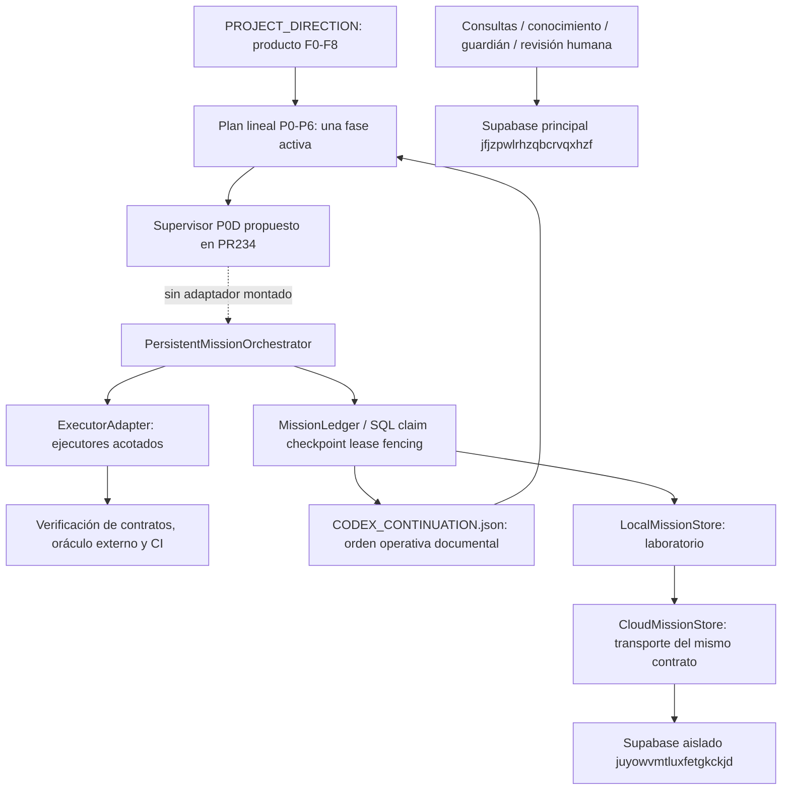

> Actualización P0: el inventario público actual está minimizado; [revisión y recuperación](P0_RECONCILIATION_REVIEW_20261114.md). Rutas personales/configuración compartida de la captura original se conservan cifradas localmente. Los commits históricos siguen accesibles. Los apartados históricos no certifican el estado posterior.

# Auditoría forense Victoriosas Autopilot · 14/11/2026

Fecha de referencia y comunicación: America/Montevideo. Las capturas JSON usan UTC; parte corresponde a 15/11 UTC y sigue siendo 14/11 en Uruguay. Base contrastada: `a4ca9dd31afa6f576d0bd5e52bc83ffb72e9272c`. Rama exclusiva `codex/forensic-audit-20261114`. Auditoría de evidencia realizada por Codex; no certificación externa ni garantía de ausencia de vulnerabilidades.

## 1. Resumen ejecutivo y alcance real

Se inspeccionaron 83 rutas únicas (95 registros iniciales normalizados), 72 worktrees registrados, 49 ramas GitHub y las 17 PR abiertas. Se conservaron cambios locales, ramas, backups, sesiones, credenciales y recursos cloud. Los datos de clientes no se consultaron. La revisión de código se concentra en contratos de misión, persistencia, continuidad, permisos y consultas, con mapa estático del resto; no afirma revisión manual de cada línea.

`C:/autopilot` permanece en `a6cff5aba04e752cb010926b88c24fd4abfe84b6`, con 260 entradas de estado local. No está sincronizado globalmente con main. Producción Vercel READY y GET `/api/health` coinciden en `9d6bbdb5f7c7200fe62463cd904314edbb9f86f0`, anterior a main. P0C está fusionado; #234 sigue DRAFT, sin montaje al runtime. No hay evidencia de un supervisor operativo permanente.

**Resultado:** inventario y reconciliación preparados; consolidación documental realizada; eliminación de recursos existentes retenida por cambios exclusivos, consumidores no demostrados y autorizaciones específicas. P0 continúa activa para cerrar esas verificaciones. No se inicia desarrollo paralelo ni se modifica producción.

## 2. Método, límites y protección

Se leyeron AGENTS local/global pertinente, dirección, checkpoint, instrucciones Copilot y skills de coordinación/seguridad/fases. Se usaron Git/gh, metadatos Windows, lectura de configuración con lista permitida de campos y MCP autenticados. El inventario no es una imagen forense atómica: tamaños/estados pueden variar durante la medición; la fila del propio worktree precede instalación de dependencias y generación de informes.

Los tamaños son bytes lógicos, sin seguir enlaces/junctions; raíces anidadas se solapan y NO deben sumarse. Dos errores de acceso pertenecen a un proyecto ajeno; se conserva. Paths ausentes quedan desconocidos, no eliminables. No se ejecutó clean/reset/force/prune, stash, migración remota, dispatch, modelo, envío, deploy manual ni promoción productiva. El push documental de PR235 sí generó previews automáticos de Vercel, separados de producción. Un proceso visible no prueba escritura; no fue posible asociar todos los PID a cwd/archivos ni descartar otros hosts.

## 3. Inventario de recursos

Manifiesto: [AUTOPILOT_RESOURCE_MANIFEST_20261114.json](AUTOPILOT_RESOURCE_MANIFEST_20261114.json). Detalle verificable con SHA, rama, remoto, estado, diferencias exclusivas, hashes de fuentes locales seleccionadas y respaldo: [resources.json](evidence-20261114/resources.json).

Dos repositorios locales ajenos usan otro remoto; no pertenecen a este Git y no se publica su identidad local. `C:/autopilot-audit-ready-updated` no tiene .git: 157 diferencias en los árboles de fuentes seleccionados frente a main; contiene configuración de entorno que no se leyó. No se puede tratar como copia redundante. E:/AutopilotTemp, QA y Recovery quedan DESCONOCIDO hasta acreditar propietario/contenido/recuperación. El worktree temporal `pr6-current` está registrado como prunable y ausente; no se borró su metadato.

| Recurso lógico | Decisión | Estado local contado |
| --- | --- | ---: |
| `R001 worktree:autopilot` | CONSERVAR | 260 |
| `R002 unclassified-or-container:R002` | CONSERVAR | 0 |
| `R003 existing-backup-container` | CONSERVAR | 0 |
| `R004 unclassified-or-container:R004` | DESCONOCIDO | 0 |
| `R005 worktree:autopilot-mission-20261025` | CONSOLIDAR | 0 |
| `R006 unclassified-or-container:R006` | CONSERVAR | 0 |
| `R007 unrelated-project:R007` | CONSERVAR | 52 |
| `R008 unrelated-project:R008` | CONSERVAR | 3 |
| `R009 shared-tool-state` | CONSERVAR | 0 |
| `R010 unrelated-project:R010` | CONSERVAR | 0 |
| `R011 worktree:autopilot-continuation-v5-20261109` | CONSOLIDAR | 0 |
| `R012 worktree:autopilot-f3-guardian-injection-20261108` | CONSOLIDAR | 0 |
| `R013 worktree:autopilot-public-health-20261106` | CONSOLIDAR | 0 |
| `R014 worktree:autopilot-victoriosas-skills-v2` | CONSOLIDAR | 0 |
| `R015 unclassified-or-container:R015` | DESCONOCIDO | 0 |
| `R016 unclassified-or-container:R016` | DESCONOCIDO | 0 |
| `R017 unclassified-or-container:R017` | DESCONOCIDO | 0 |
| `R018 worktree:activation-preservation-20261110` | CONSOLIDAR | 0 |
| `R019 worktree:admin-auth-upstream-status-20261108` | CONSOLIDAR | 0 |
| `R020 worktree:alignment-audit-20261105` | CONSERVAR | 13 |
| `R021 worktree:api-404-build-isolation-20261108` | CONSOLIDAR | 0 |
| `R022 worktree:auth-test-review-20261109` | CONSOLIDAR | 0 |
| `R023 worktree:autonomy-continuity-20261112` | CONSERVAR | 8 |
| `R024 worktree:beauty` | CONSOLIDAR | 0 |
| `R025 worktree:clinical-final-qa-20261031` | CONSOLIDAR | 0 |
| `R026 worktree:clinical-navigation-20261031` | CONSERVAR | 2 |
| `R027 worktree:cloud-ledger-adapter-20261112` | CONSERVAR | 16 |
| `R028 worktree:comercio` | CONSOLIDAR | 0 |
| `R029 worktree:configuration-decisions-20261110` | CONSOLIDAR | 0 |
| `R030 worktree:consultation-admin-d-20261111` | CONSOLIDAR | 0 |
| `R031 worktree:continuity-validation-20261106` | CONSOLIDAR | 0 |
| `R032 worktree:copy-remoto` | CONSOLIDAR | 0 |
| `R033 worktree:discovery-20261031` | CONSOLIDAR | 0 |
| `R034 worktree:discovery-plan` | CONSERVAR | 38 |
| `R035 worktree:diseno` | CONSERVAR | 48 |
| `R036 worktree:f1-api-auth-review-20261109` | CONSOLIDAR | 0 |
| `R037 worktree:f1-public-health-redaction-20261110` | CONSOLIDAR | 0 |
| `R038 worktree:f1-readiness-20261110` | CONSOLIDAR | 0 |
| `R039 worktree:f3-authorized-evaluation-20261106` | CONSOLIDAR | 0 |
| `R040 worktree:f3-quality-recovery-20261106` | CONSOLIDAR | 0 |
| `R041 worktree:forensic-audit-20261114` | CONSERVAR | 3 |
| `R042 worktree:github-maintenance-20261031` | CONSOLIDAR | 0 |
| `R043 worktree:glm53-opencode-20261031` | CONSERVAR | 16 |
| `R044 worktree:hosted-ledger-20261112` | CONSOLIDAR | 0 |
| `R045 worktree:integracion-local-20261029` | CONSOLIDAR | 0 |
| `R046 worktree:mission-native-activation-20261109` | CONSOLIDAR | 0 |
| `R047 worktree:mission-native-host-20261109` | CONSOLIDAR | 0 |
| `R048 worktree:mission-operator-20261109` | CONSOLIDAR | 0 |
| `R049 worktree:mission-planner-20261109` | CONSOLIDAR | 0 |
| `R050 worktree:mission-runner-20261109` | CONSOLIDAR | 0 |
| `R051 worktree:mission-trigger-20261109` | CONSOLIDAR | 0 |
| `R052 worktree:native-window-evidence-20261110` | CONSOLIDAR | 0 |
| `R053 worktree:opencode-workstation-20261031` | CONSOLIDAR | 0 |
| `R054 worktree:operaciones` | CONSOLIDAR | 0 |
| `R055 worktree:ord204g-early-diagnostics-20261110` | CONSOLIDAR | 0 |
| `R056 worktree:ord204g-preflight-handoff-20261110` | CONSOLIDAR | 0 |
| `R057 worktree:ord204g-viki-bridge-20261110` | CONSOLIDAR | 0 |
| `R058 worktree:ord204g-window-manager-20261110` | CONSOLIDAR | 0 |
| `R059 worktree:permanent-supervisor-p0d-20261114` | CONSOLIDAR | 0 |
| `R060 worktree:plan-cloud-20261111` | CONSOLIDAR | 0 |
| `R061 worktree:pr-cleanup-168-20261106` | CONSOLIDAR | 0 |
| `R062 worktree:pr-cleanup-186-20261106` | CONSOLIDAR | 0 |
| `R063 worktree:pr-cleanup-187-20261106` | CONSOLIDAR | 0 |
| `R064 worktree:pr-cleanup-188-20261106` | CONSOLIDAR | 0 |
| `R065 worktree:queue-fencing-20261109` | CONSOLIDAR | 0 |
| `R066 worktree:candidate` | CONSOLIDAR | 0 |
| `R067 worktree:candidate` | CONSOLIDAR | 0 |
| `R068 worktree:reconcile-pr217-20261111` | CONSOLIDAR | 0 |
| `R069 worktree:reconcile-pr218-20261111` | CONSOLIDAR | 0 |
| `R070 worktree:self-development-20261110` | CONSOLIDAR | 0 |
| `R071 worktree:self-development-f1-20261110` | CONSOLIDAR | 0 |
| `R072 worktree:shared-api-mount-20261108` | CONSOLIDAR | 0 |
| `R073 worktree:victoriosas-depth-20261031` | CONSERVAR | 4 |
| `R074 worktree:victoriosas-preview-20261031` | CONSOLIDAR | 0 |
| `R075 worktree:victoriosas-route-fix-20261031` | CONSERVAR | 4 |
| `R076 worktree:victoriosas-ux-20261031` | CONSERVAR | 4 |
| `R077 worktree:victoriosas-consultation-lab` | CONSOLIDAR | 0 |
| `R078 worktree:autopilot` | CONSERVAR | 1 |
| `R079 worktree:autopilot` | CONSOLIDAR | 0 |
| `R080 worktree:autopilot` | CONSERVAR | 27 |
| `R081 worktree:autopilot` | CONSOLIDAR | 0 |
| `R082 worktree:autopilot` | CONSERVAR | 16 |
| `R083 unavailable-registration:R083` | DESCONOCIDO | 0 |

## 4. Arquitectura comprobada y dependencias

`executorAdapter.ts` define contratos; `missionRuntime.ts` valida DAG, envelope, objetivo, permisos y aceptación de checkpoints. `missionPlanner.ts` solo admite `synthetic.ensure_verified_artifact`, recursos y acciones cerrados. `sixAgentPersistence.ts` usa RPC y conserva token en host; `LocalMissionStore` adapta ese contrato al laboratorio; `CloudMissionStore` hereda el transporte y restringe proyecto, usuario, TLS y operaciones. No son dos schedulers: reutilizan semántica SQL; los dos proyectos de datos tienen propósitos distintos y no deben fusionarse.

`selfDevelopment.ts` implementa un ledger local monomisión y reparación sintética de boundedCount. `readinessDevelopment.ts` admite variantes hash de un módulo concreto y oráculo externo. No existe en esos módulos un ejecutor Codex general capaz de implementar cualquier misión. `missionContinuation.ts` asesora resume/busy/terminal; la autoridad de claim sigue en SQL. PLAN Cloud emite handoff bloqueado en workflow_run, y hosted-status/resume son manuales con SHA/environment.

Mapa estático: [dependency-graph.json](evidence-20261114/dependency-graph.json), 234 módulos y 527 aristas. Incluye imports de tipos, no resuelve todas las expresiones/alias y no demuestra código muerto. Cuatro SCC: types↔salesChannel, editorial↔clientEditorial y executorAdapter↔missionPlanner incluyen aristas de tipos; productSourcingService↔autoPublisher contiene imports runtime y merece desacoplamiento si el módulo histórico vuelve a tocarse. No se retiró código por falta de referencias en este análisis.

## 5. Subsistemas: estados separados

| Subsistema | Definido / implementado | Probado | Fusionado | Desplegado / ejecutado / bloqueo |
| --- | --- | --- | --- | --- |
| Runtime, planner y executor sintético | Sí, objetivo cerrado | verify actual y CI main; fixtures SQL en CI | Sí | No generalizar a operación autónoma |
| P0B/P0C CloudMissionStore | Sí, mismo contrato | TLS/ACL/fencing fixtures CI; metadatos alojados leídos ahora | #231/#232/#233 | Una misión alojada y 7 eventos; hosted-status histórico SUCCESS. Recuperación real de efectos entre hosts NO probada |
| P0D supervisor | Función pura, sin IO ni adaptador | 8/8 unitarias; probe state inválido devuelve propose_resume | NO, #234 | No montado, no permanente, no dispatch |
| ORD-204G Windows | Host/diagnóstico/ventanas propuestos | CI de ramas; evidencia histórica parcial | Cadena #213→#220→#222/#223 abierta | Recuperación Windows actual no reejecutada ni acreditada |
| PLAN Cloud | Inventario y modos manuales; handoff cerrado | CI + run histórico 43657434746 | #228/#230 y P0C | workflow_run sale 1 intencionalmente; no continuación automática |
| Autodesarrollo | Dos adaptadores locales acotados | Suite actual y oráculos; historia #217/#218 | Sí | No ejecutor Codex general ni servicio permanente |
| F1 consultas | Rutas, consentimiento, retención, auth, outbox, dedup | verify; GET config200/admin401 ahora | Sí | Dominio9d6bbdb; no nuevo canario ni recepción humana verificados |
| F2 conocimiento | Versionado privado y aprobación independiente | SELECT agregado: 17 últimas fichas aprobadas/vigentes, 0 tarifas | Sí | Metadatos actuales; no reevaluación profesional del contenido |
| F3 Guardián/IA | Políticas deterministas y no_send | Pruebas aisladas; evaluación histórica parcial | Base presente, #198/#199 divergentes | Sin nueva inferencia ni habilitación; corpus completo real no certificado por esta auditoría |
| F4 material/UI | #225–#227 backend presente, #229 UI pendiente | Contratos en suite; CI rama229 | Backend sí / UI no | Migraciones staged no se aplican por existencia de código |
| Comercio histórico | Aún hay módulos y cron Vercel | Guardas en tests; no disparo remoto | Sí | Fuera de dirección vigente. No eliminar sin consumidores ni reactivar |

## 6. GitHub, ramas y PR

[branch-comparisons.json](evidence-20261114/branch-comparisons.json) contiene SHA, merge-base, ahead/behind y paths por cada rama remota actual. El fetch se hizo sin prune. [pulls-history.json](evidence-20261114/pulls-history.json) conserva el inventario de PR cerradas/fusionadas (límite1000, superior al total existente). Se reconstruyó por log la secuencia #204 API/auth → #207–#212 misiones → #216 claims → #225–#227 conocimiento/material → #217/#218 autodesarrollo → #230 handoff → #231 P0B → #232/#233 P0C. La fecha del commit no autoriza integración.

| PR | Head exacto observado | Clasificación | Evidencia / decisión |
| --- | --- | --- | --- |
| [#234](https://github.com/Victoriosas/autopilot/pull/234) | `3ce7fdf6f3e7ea955a705f20f771a91ec8cb1f14` | Requiere investigación | Pura y sin integración; 8/8 unitarias. Una observación con state inesperado devuelve propose_resume. Validar frontera runtime antes de conectar. |
| [#229](https://github.com/Victoriosas/autopilot/pull/229) | `d666cccfc49f6fea183b1cb5f8e028f839628881` | En conflicto | UI material pendiente; main ya incluye #225–#227. Reconciliar solo la UI y contratos actuales, sin reintroducir lógica anterior. |
| [#224](https://github.com/Victoriosas/autopilot/pull/224) | `9042122323887939b95ab7c9dc653742e0073517` | Integrable | Solo evidencia histórica de preflight. Integrable documentalmente tras actualizar referencias, no acredita host recuperado. |
| [#223](https://github.com/Victoriosas/autopilot/pull/223) | `e034db1dd1e28f71febd895c19d62d20ff5616bd` | Dependiente de otra | #220; bridge read-only y misma cuenta camelRun/viki. Sin herramientas conectadas hoy. |
| [#222](https://github.com/Victoriosas/autopilot/pull/222) | `e2f68d2c9be7423755c2b88d4ab5ee579f1bc65c` | Dependiente de otra | #220; gestor de ventanas no sustituye ledger ni garantiza recuperación Windows. |
| [#220](https://github.com/Victoriosas/autopilot/pull/220) | `633faa7f9517a6d6edc82158cd125b09a66f6312` | Dependiente de otra | #213; diagnósticos del host, no ejecución recuperada comprobada. |
| [#219](https://github.com/Victoriosas/autopilot/pull/219) | `ca7f4237211ac6e001eaa81a5ee4239f709f8bab` | En conflicto | Evidencia ORD-204G y script con trabajo exclusivo. Conservar; no usar como arranque actual. |
| [#213](https://github.com/Victoriosas/autopilot/pull/213) | `15720289647da59c19cc2c19c7f123ee84259a31` | En conflicto | Base del host nativo ORD-204G. Resolver frente al runtime actual antes de #220/#222/#223. |
| [#202](https://github.com/Victoriosas/autopilot/pull/202) | `eb92a0cef9c5d50ea578f4a532e7b56cb600cdab` | Ya incorporada funcionalmente | #204 está en main; ambos archivos de código de la propuesta son idénticos al main observado. |
| [#201](https://github.com/Victoriosas/autopilot/pull/201) | `7da72d3634c378d4cd1f6b41aa99b30f0a6001ce` | Ya incorporada funcionalmente | #204 incorpora 404 y builds separados; 5/7 archivos de código idénticos, restantes evolucionaron. Base formal #200. |
| [#200](https://github.com/Victoriosas/autopilot/pull/200) | `039ecf3503cb74b8f7c32b1fd4e8d71b7fa2f72a` | Ya incorporada funcionalmente | #204 incorpora montaje común; src/http/createApp.ts y smoke actual acreditan el comportamiento. Diferencias posteriores no son razón para reintegrar. |
| [#199](https://github.com/Victoriosas/autopilot/pull/199) | `2607a427d77f3b523de120a2d41ae1f1898b146f` | En conflicto | Guardián F3; cambios exclusivos y base divergente. Revisión semántica focalizada pendiente, no reemplazar main con variante antigua. |
| [#198](https://github.com/Victoriosas/autopilot/pull/198) | `9d7edf1cfe90562cad29771738b038f06f7f3696` | Requiere investigación | Evidencia histórica F3; preservar documentos exclusivos. No prueba aprobación completa vigente de 40+6. |
| [#169](https://github.com/Victoriosas/autopilot/pull/169) | `f9924558237d033cfae7f530524fa72348ea4297` | En conflicto | Git mergeable/behind pero validate FAILURE: migración Express 5 sin contrato verificado. Conflicto técnico, no textual. |
| [#124](https://github.com/Victoriosas/autopilot/pull/124) | `253309a253d7c467d1286710c391817a87339d9e` | Obsoleta | Alcance mixto catálogo/correos/agentes histórico, fuera de dirección actual. Tiene trabajo exclusivo; no cerrar ni borrar automáticamente. |
| [#122](https://github.com/Victoriosas/autopilot/pull/122) | `0623fbc41b1c0aba0a1c6131698acbdb106fd0e5` | Requiere investigación | Precios/Guardián fase2 históricos; hay trabajo exclusivo y conflicto. Tarifas actuales no aprobadas; mantener borrador. |
| [#90](https://github.com/Victoriosas/autopilot/pull/90) | `b12c7da28b7b862d656681465954e48dfa8932b1` | Obsoleta | Preparación social fuera de fase actual. Contenido exclusivo se conserva; no publicar perfiles ni cerrar por antigüedad. |

Todas siguen abiertas DRAFT; ninguna fusionada/cerrada por esta auditoría. Detalle de blobs, archivos y dependencias: [pr-reconciliation.json](evidence-20261114/pr-reconciliation.json). Una equivalencia funcional por #204 no implica que todos los blobs/documentos sean idénticos; rescatar contenido exclusivo antes de proponer cierre.

CI main: validate y postgres SUCCESS al SHA base; CodeQL SUCCESS. Hay checks continuation FAILURE intencionales en ese mismo SHA: **main no tiene todos los checks verdes**. Supabase Preview de main reporta success; en las PR abiertas se observa skipped, que no acredita migraciones ni integración. #169 conserva validate FAILURE aunque Git no detecte conflicto textual.

La API de protección clásica responde404 Branch not protected, pero el ruleset **activo**25446201 sí exige PR, resolución de conversaciones, validate/postgres estrictos, prohíbe borrado y non-fast-forward, y no tiene bypass actors. No confundir404 clásico con rama desprotegida. Aprobaciones PR requeridas:0. auto-merge=false; permisos Actions predeterminados read; Actions no puede aprobar reviews.

Environment p0c-hosted-ledger: reviewer requerido, prevent_self_review=true, rama main, can_admins_bypass=true preexistente. La excepción autorizada del run43657434746 no es permiso reutilizable. Existen además Preview, Production, VERCEL y un environment llamado OPENAI_API_KEY; su nombre no es un secreto. No se eliminaron ni se cambió protección. Secrets solo por nombres: CAMELAI_API_KEY, OPENAI_API_KEY y CA/password P0C en environment. Variable revisada P0C_HOSTED_REVIEWED_SHA coincide con main base; modo supabase-session. El siguiente commit NO amplía esa autorización.

Artifacts/caches completos observados:88 y55 respectivamente; se inventariaron metadatos, no se descargaron ni borraron. Runs: inventario de metadatos paginado; logs profundos solo del bloqueo continuation y evidencias relevantes. No se reejecutaron jobs ni se asumió coste total cero.

## 7. Codex, skills, MCP, procesos y cadencias

CLI0.167.0, Node24.15.0, gh2.92.0. La configuración global del host se revisó en privado y no se publica; no sustituye restricciones del proyecto. Config de proyecto `.codex/config.toml` ausente en este checkout. Se extrajeron solo claves, nombres, transportes y flags: [codex.json](evidence-20261114/codex.json). No se leyó auth.json, .env, valores env, secretos, contenido de sesiones ni logs de clientes.

14 skills del repositorio, 6 en .codex/skills y 5 en .agents/skills; plugins tienen sus propios paquetes adicionales y no están incluidos en esos conteos. Principales: desarrollo-autonomo coordina ejecución y control-de-fases decide prioridad bajo PROJECT_DIRECTION. Auxiliares: safety, core, roles, ahorro y skills específicas a demanda. plan describe inventario cloud, no autoridad de producto. Las dos skills de ahorro se solapan en propósito; conservarlas y dirigir nuevas órdenes al coordinador existente. No desinstalar paquetes compartidos. No se acredita análisis exhaustivo de consumidores de todas las skills/plugin caches.

La configuración MCP compartida no se publica en el inventario minimizado. El hecho de estar enabled no acredita conexión. Supabase/Vercel/GitHub/camelRun/viki se consultaron con éxito; los conectores comerciales restantes no se activaron. camelRun/viki devolvieron los mismos nueve agentes, todos loaded=false/toolsConnected=false; no son dos motores distintos demostrados. Schedules consultados para supervisor y dos agentes ORD-204G: vacíos. No se invocó ningún modelo ni se examinó conversación remota.

Automatización local victoriosa-autopilot-6h ACTIVE, de tipo heartbeat con target_thread_id; configuración leída y tarjeta view solicitada. No usa cwds/project_id en su TOML: su destino es un chat, no un nuevo proyecto. Intención programada no demuestra recibo de esta rama ni ejecución futura. Su prompt conserva prioridades históricas de marketing #84/#81 (ambas issues siguen OPEN), referencia a octubre y una orden de mantener formularios cerrados, mientras la configuración pública actual está habilitada. AGENTS/dirección actuales prevalecen; el prompt activo requiere reconciliación explícita antes de considerarlo alineado con este plan. No se lo modificó ni se presume que ejecutó esas instrucciones.

Tarea Windows Victoriosas-Autopilot-Synthetic-Demo en estado numérico1 (Disabled); no se modificó. Existen procesos Codex/Node/Postgres y dos entradas de thread-writer-locks; no se detuvieron ni se borraron locks por edad. [processes.json](evidence-20261114/processes.json) contiene PID/parent/nombre y paths detectados, sin commandline completo; cwd desconocido se deja explícito.

Cadencias existentes de distinto ámbito: monitor6h Codex; workflows de salud/infraestructura/observabilidad; cron Vercel sourcing6h; cron SQL retention-hourly. Se conserva la retención de privacidad. SourcingScheduler de Node requiere AUTOPILOT_LEGACY_SOURCING_ENABLED=true y config.isEnabled. Esa guarda no prueba cuál es la variable en producción. El cron Vercel histórico merece revisión de consumidores, sin ejecutarlo ni duplicarlo para misiones.

## 8. Cloud y permisos

Ambos Supabase ACTIVE_HEALTHY. Principal:41 migraciones, todas las43 tablas public/private observadas con RLS; 66 versiones de conocimiento,24 aprobaciones históricas, pero **17 slugs actuales /17 aprobadas vigentes /0 tarifas**. No contar versiones como tratamientos. Privilegios de tabla y políticas necesitan interpretación conjunta; la presencia de grants no demuestra exposición de filas. No se publican datos ni se certifica seguridad total.

Ledger aislado:4 tablas con RLS, rol autopilot_cloud_runner sin superuser/createdb/createrole/replication/bypassrls y sin membresías; sin grants de tablas para PUBLIC/anon/authenticated en el catálogo consultado. Siete RPC EXECUTE para runner, una tarea y siete eventos. SSL de la sesión MCP=true; esto **no prueba por sí solo** el transporte del runner. Ese transporte verify-full+backendTLS está acreditado por código y run histórico43657434746, no reejecutado. No hubo cambios de TLS/RLS/ACL ni lecturas de credenciales.

Vercel proyectoautopilot, frameworkvite, último production listado READY9d6bbdb y health mismo SHA. get_project es una vista reducida y no expone Git deployment flags: no se afirman settings actuales que el API no devolvió. Costes, cuotas, presupuesto total y facturas de proveedores quedan NO COMPROBADOS. No se compraron servicios ni se gastó en inferencia. Resend/Cloudflare/WhatsApp no se conectaron end-to-end de nuevo; un GET correcto no prueba recepción.

## 9. Riesgos, contradicciones y duplicaciones

1. **Continuidad aún cerrada:** reason cloud_ledger_adapter_not_configured es fijo en workflow_run incluso después de P0C. Es una guarda deliberada hoy, con diagnóstico semántico desactualizado. No quitarla para obtener CI verde; separar habilitación futura de diagnóstico.
2. **P0D no es supervisor operativo:** sin imports de montaje ni adaptador. Probe no invasivo en head3ce7fdf: state='unexpected' produce propose_resume; TypeScript no valida entrada remota en runtime. Antes de conectar exigir enumeración/booleanos/fase/binding/versión verificados y casos negativos. No ejecutó acciones ni demuestra vulnerabilidad explotable.
3. **Frontera P0D/runtime:** los estados del supervisor (running/failed) y checkpoint (in_progress/retry_wait/ready_to_complete/blocked) necesitan mapping explícito. Una lease expirada running devuelve wait y requiere reconciliador existente; ningún heartbeat debe inferir permiso de dispatch.
4. **PC divergente:** numerosos archivos exclusivos sin respaldo nuevo ni propietario único. Ausencia de commits no es inactividad. Estado de procesos no acredita ausencia de escritores.
5. **Documentos históricos compiten por actualidad:** el encabezado P0C histórico decía preparado con enmiendas posteriores; esta propuesta agrega un índice actual y conserva ese historial. El nuevo prompt/plan apunta al JSON único. No leer entradas antiguas como estado vigente.
6. **Solapamiento de planes, ledgers locales y skills:** DevelopmentLedger es laboratorio acotado, CloudMissionStore transporte del contrato existente; no promoverlos a autoridades paralelas. Planes históricos no gobiernan nuevas misiones.
7. **Tests y prueba real:** 8 unitarias P0D no acreditan observación/dispatch; suites mock/sintéticas no son canario; una lectura de misión completed no es recuperación interhost. verify glob no cubre todas las tests/DB ni todos los paquetes tools.
8. **Módulos históricos y ciclo runtime:** sourcing/autoPublisher, Shopify/pagos/rutas antiguas siguen teniendo consumidores importados. No son candidatos demostrados de código muerto. Mantener gates cerradas y separar eventual retirada revisada de la auditoría.
9. **Fallo local conservado:** primer verify512 aprobadas/1 archivo fallido, total513; beautyDiscoveryPlan pasó4/4 aislada. Segundo verify516/516 completo. No se determinó causa del primer fallo ni se cambió test/concurrencia para ocultarlo.

No se encontró en esta revisión focalizada una vulnerabilidad explotable confirmada para publicar. Cualquier hallazgo posterior sensible debe ir al canal privado security/advisories/new, sin reproducir secretos en esta PR pública.

## 10. Conservación, limpieza y recuperación

Se conservó todo recurso preexistente. Se compararon24 fuentes locales de cloud-ledger-adapter/autonomy-continuity:8 coinciden con main normalizando CRLF,13 con blobs históricos de main y3 solo difieren por una línea vacía adicional. [Evidencia](evidence-20261114/local-cloud-reconciliation.json). No reintegrar esos cambios ni confundirlos con código exclusivo. Quedan otros árboles con cambios sin atribución completa.

Única eliminación realizada: archivo intermedio de metadatos generado por esta auditoría, sustituido por resumen minimizado; no es limpieza de recursos históricos. Se consolidó la dirección documental mediante plan y prompt únicos, y referencias en continuidad. No hubo evidencia suficiente para borrar caches ajenas: no se probó falta de consumidores.

Propuesta agrupada A: worktrees/refs integrados solo tras selección explícita, comparación del estado inmediatamente anterior, respaldo cifrado de cambios y prueba de restauración. GrupoB: cierre #200/#201/#202 después de preservar notas exclusivas y apuntar a #204. GrupoC: automatizaciones/plugins/servicios, sin propuesta de retirada todavía. Ninguna propuesta está ejecutada ni usa aprobación implícita.

Recuperación: para esta PR, revertir sus cambios documentales en otra PR; ningún SQL/servicio se debe revertir. Para recursos locales, detener solo escritores propios tras identificarlos, conservar refs y cambios, usar copia cifrada fuera de Git si contiene datos sensibles, verificar hash y restauración de muestra antes de autorizar borrado. Nunca restaurar secretos al repositorio ni readmitir la misión terminal.

## 11. Estrategia única y evidencia de cierre

Autopilot dirige; Codex ejecuta; verificación comprueba; el ledger conserva misión/efectos. PRODUCT_DIRECTION conserva producto F0–F8; [MASTER_LINEAR_DEVELOPMENT_PLAN.md](../MASTER_LINEAR_DEVELOPMENT_PLAN.md) organiza P0–P6 sin sustituir esa dirección. [CODEX_LINEAR_CONTINUATION_PROMPT.md](../CODEX_LINEAR_CONTINUATION_PROMPT.md) es la entrada reutilizable; CODEX_CONTINUATION.json sigue siendo el único checkpoint operativo documental. SQL es autoridad de estados de misión; no se replica una cola en Markdown.

Comandos efectivos: git ls-remote/fetch sin prune, worktree list, status porcelain, merge-base, cherry, rev-list, diff de paths/blobs, fsck --connectivity-only --no-dangling; gh pr/issue list y APIs metadata paginadas; Get-CimInstance y Get-ScheduledTask; MCP SELECT de catálogos/agregados; npm ci --ignore-scripts; verify completo repetido por primer fallo; unitarias P0D; probe inválido; GET público con PowerShell. El monitor Node remoto falló UND_ERR_CONNECT_TIMEOUT; no se ocultó con el GET exitoso de otra pila.

El informe de consolidación registra checks finales de la propuesta. Permanecen pendientes: propietarios/backup/restauración de cambios locales, acople seguro P0D, recuperación interhost real, coste total y recepción humana actual. No declarar producto completo ni servicio24/7.
